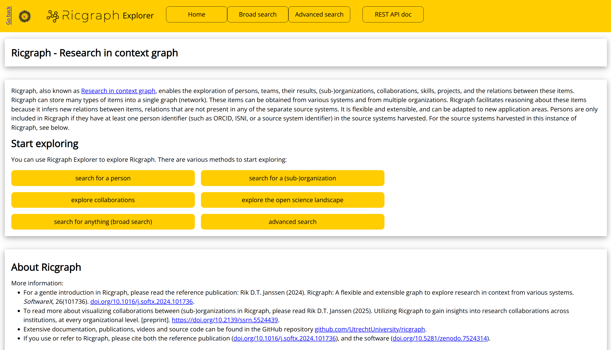

# Ricgraph REST API

You can use the Ricgraph REST API to get data from Ricgraph, or 
to execute predefined queries in Ricgraph and Ricgraph Explorer, 
in such a way that your code is not dependent on any Ricgraph 
code. 
It allows you to
programmatically get items from Ricgraph,
as an alternative to using the user
interface [Ricgraph Explorer](ricgraph_explorer.md#ricgraph-explorer). 

This will only work if someone has provided a Ricgraph
instance, which you can access over the web.
For example, 
you can use the Open Ricgraph demo server. This is the easiest method.
Read [Use of the Ricgraph REST API](#use-of-the-ricgraph-rest-api)
below to find its REST API server.

Alternatively, you can run Ricgraph 
on your own computer or on a cloud service 
such as SURF Research Cloud.
Or someone else can host it for you or for a 
community of users.

The Ricgraph REST API returns results 
in a [JSON format](https://en.wikipedia.org/wiki/JSON). It uses
the [OpenAPI standard](https://www.openapis.org).
Read more about 
[REST (representational state transfer)](https://en.wikipedia.org/wiki/REST), or
read more about 
[API (application programming interface)](https://en.wikipedia.org/wiki/API).

On this page, you can learn more about:

* [Installation of the Ricgraph REST API](#installation-of-the-ricgraph-rest-api)
* [Use of the Ricgraph REST API](#use-of-the-ricgraph-rest-api)
* [Ricgraph REST API endpoint documentation](#ricgraph-rest-api-endpoint-documentation)
* [Generate the Ricgraph REST API documentation page](#generate-the-ricgraph-rest-api-documentation-page)


## Installation of the Ricgraph REST API
You can skip this section if you plan to use the
[Open Ricgraph demo
server](https://www.ricgraph.eu/pilot-project-open-ricgraph-demo-server.html).

The Ricgraph REST API is part of Ricgraph Explorer. Read [how to start Ricgraph 
  Explorer](ricgraph_explorer.md#how-to-start-using-ricgraph-explorer).
Depending on your needs, you might also want to read:

* [Install and use a service unit file to run Ricgraph Explorer and the Ricgraph REST 
  API](ricgraph_as_server.md#use-a-service-unit-file-to-run-ricgraph-explorer-and-the-ricgraph-rest-api).
* [Use Apache, WSGI, and ASGI to make Ricgraph Explorer and the Ricgraph
  REST API accessible from outside your virtual 
  machine](ricgraph_as_server.md#use-apache-wsgi-and-asgi-to-make-ricgraph-explorer-and-the-ricgraph-rest-api-accessible-from-outside-your-virtual-machine).


## Use of the Ricgraph REST API
A call to a REST API consists of a hostname or IP address, 
sometimes a port number, 
the path */api/*, followed
by a REST API endpoint.
For example, in
```
http://127.0.0.1:3030/api/person/search?value=John+Doe
```
*127.0.0.1* is the IP address, *3030* is the port number,
*http://127.0.0.1:3030/api* is the path to the REST API server,
*/person/search* is the endpoint, *value* the name of a query parameter to the REST API,
and *John+Doe* the value for the query parameter.

You can find the REST API server of the Open Ricgraph demo server
by going to the page
[Pilot project Open Ricgraph demo
server](https://www.ricgraph.eu/pilot-project-open-ricgraph-demo-server.html).
That page lists the link to the Open Ricgraph demo server.
Click on it and then 
click the button "REST API doc" in the top bar. 
On the next page, in the left column, click
on "API servers". Use that value instead of
*http://127.0.0.1:3030/api* above.

Ricgraph Explorer provides documentation 
for the REST API. It lists the various endpoints
and parameters, and you can try out each endpoint with values for parameters as you like.
To do this, click the "REST API doc" button in the top bar of 
Ricgraph Explorer.
The figure below shows this button.




## Ricgraph REST API endpoint documentation
Read 
the [Ricgraph REST API documentation page](ricgraph_restapi_gendoc.md#ricgraph---research-in-context-graph-rest-api).
This page is automatically generated from the OpenAPI YAML specification file.

## Generate the Ricgraph REST API documentation page
Please read
[Create the Ricgraph REST API
documentation](ricgraph_misc_scripts.md#create-the-ricgraph-rest-api-documentation-convert_openapi_to_mddoc).
