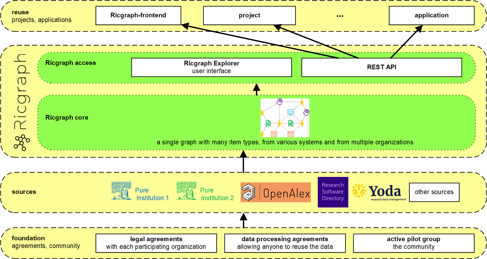
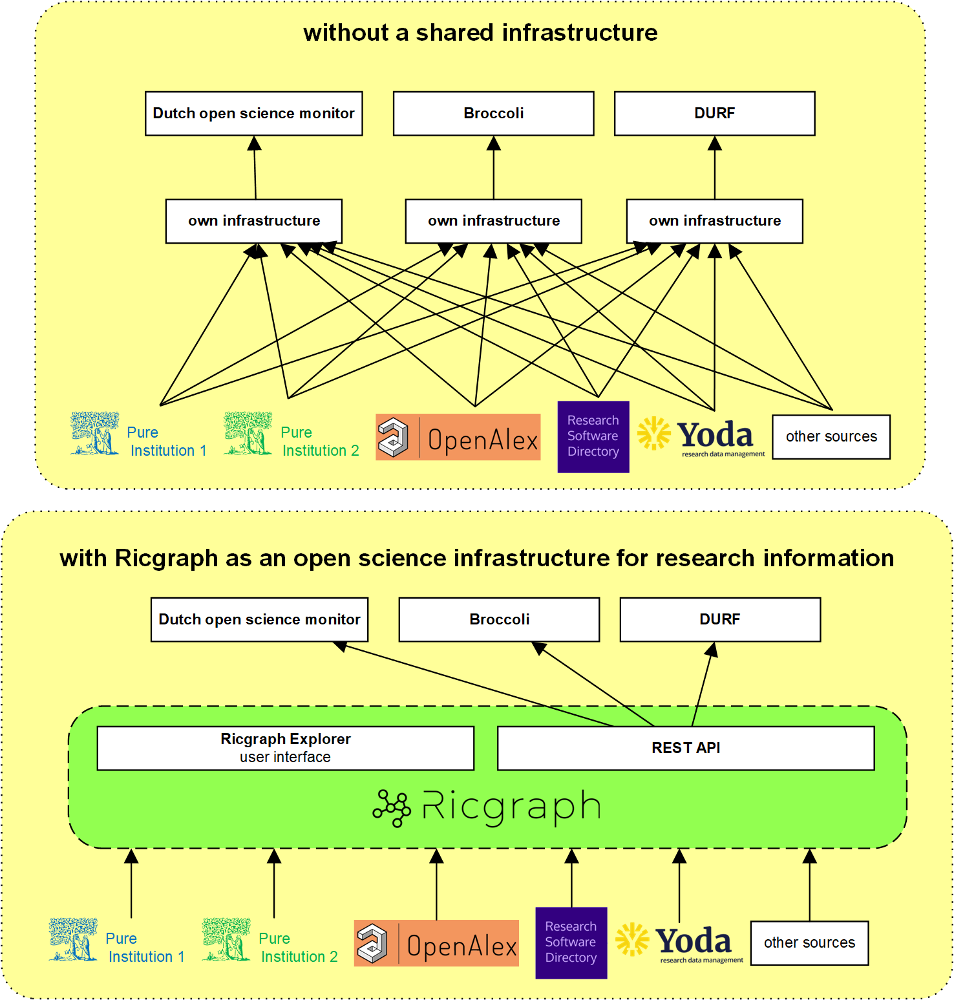

# Ricgraph as an open science infrastructure for research information

Ricgraph is an open source open science infrastructure for research information
that can store many types of items into a single graph, accessible through a
user interface ([Ricgraph Explorer](https://docs.ricgraph.eu/ricgraph_explorer.html)) 
and a [REST API](https://docs.ricgraph.eu/ricgraph_restapi.html). 
This infrastructure is operational and used in our
[Pilot project Open Ricgraph demo server](pilot-project-open-ricgraph-demo-server.md).

## What is an open science infrastructure?
An [IT infrastructure](https://en.wikipedia.org/wiki/IT_infrastructure) 
is a shared set of connected technologies that other tools
and services can build on. It provides a common foundation,
so different applications do not have to build the same basic 
systems separately.

An open science infrastructure is an IT infrastructure based
on open science principles.
These principles include sharing information, being clear 
about its sources, and supporting collaboration and fair access.

As an open science infrastructure for research information, 
Ricgraph makes research 
information easy to find, access, and reuse. 
Users can see where the information comes from and 
how it is collected. Sharing this information helps people work together.

An open science infrastructure is therefore more than just hardware
and software. 
It also connects information and makes it available for use.

## Challenges
Building an open science infrastructure for research information is not easy. To
integrate research information from various systems and from multiple
organizations is even more complicated. This is not only a technical challenge,
but also an organizational, legal, and privacy challenge. An active community
is required. 

In our pilot project, we are working on these challenges. At the moment, we
have succeeded in building the infrastructure and integrating research
information from various sources
and from multiple organizations
(for more information read the
[Ricgraph pilot project page](pilot-project-open-ricgraph-demo-server.md)).
With each
participating organization, we have legal and data processing agreements in
place, allowing anyone to reuse the research information in Ricgraph. The pilot
group is our active community.

## Examples of projects that may profit from Ricgraph as an open science infrastructure
To illustrate why
Ricgraph as an open science infrastructure for research information
is useful, we consider as an example three projects that were awarded
by Open Science NL in 2025.
[Open Science NL](https://www.openscience.nl/en)
is the Dutch national program that aims to promote and 
accelerate the transition to open science in the Netherlands. 
It does so through dedicated funding, empowering communities, 
capacity building, and supporting infrastructure.

* Awarded in the 
  [tender for an open science 
  monitor](https://www.openscience.nl/en/news/development-of-an-open-science-monitor-for-the-netherlands-underway) in October 2025:

  * [Dutch open science monitor](https://doi.org/10.5281/zenodo.17348592), a project with
    CWTS, Dialogics, and others (2 years).

    "This consortium will develop a robust, context-specific framework 
    for monitoring and evaluation, as well as a prototype dashboard 
    to visualize an open science monitor."

* Awarded in the 
  [Open Science NL call *Open Science 
  Infrastructures*](https://www.openscience.nl/en/news/45-projects-strengthen-dutch-open-science-infrastructure) in December 2025: 

  * [Broccoli for open research 
    information](https://communities.surf.nl/files/Artikel/download/Broccoli-full-proposalv1-3_budgetencontactinofremoved.pdf), 
    a project with SURF and others (4 years). 
    
    "Broccoli will bring accessible, reliable and reusable information on 
    Dutch research actors, activities, and outputs together in an open
    infrastructure that facilitates evidence-informed decision-making in the
    Dutch research system.
    The project will bring together research information experts, 
    users and providers to collectively harvest, transform and 
    curate the information needed for (a) monitoring publisher
    deals, (b) open science monitoring, and (c) responsible research evaluation."
  * [DURF, Strengthening the Netherlands research portal and institutional 
    repositories](https://communities.surf.nl/files/Artikel/download/OS%20infra%20full-proposal%20DURF%20Dutch%20Repository%20Federation_ContactandFinancialinforemoved.pdf), 
    a project with SURF and others (4 years). 
    
    "DURF will reinforce the existing
    Netherlands Research Portal and existing institutional repositories/CRIS
    systems to make availability of Dutch research output more robust, increasing
    our resilience and sovereignty.
    Lots of article PDFs are missing from repositories."

All of these projects will need to have
a collection of research information to achieve their goals.
As far as currently known (November 2026), these projects have not
yet started developing their own
infrastructure. Ricgraph can give these projects a flying start, because they
can focus on the aim of what they intend to do, and not on creating the
infrastructure to do it.

## Try it out

Explore Ricgraph as an open science infrastructure for research information
by installing the
[proof of concept frontend for Ricgraph](https://github.com/UtrechtUniversity/ricgraph-frontend)
from GitHub.

Once installed, you will have your own modern user interface for Ricgraph, 
connected to the research information available on the
[Open Ricgraph demo server](pilot-project-open-ricgraph-demo-server.md).
You can adapt the code to suit your needs, for example, 
by adding or removing buttons, changing page layouts, 
or developing new features that use the information in Ricgraph.

The frontend uses the Ricgraph REST API to 
access the Ricgraph demo server, as shown in the first figure on this page
(the "Ricgraph-frontend" box in the "reuse" bar).
This saves you the time and effort 
of creating your own research information backend. 
To get started by exploring research information, 
thanks to the infrastructure that Ricgraph provides,
you do not need to:

* install Ricgraph;
* harvest information from source systems;
* arrange agreements with organizations to process their research information;
* build your own backend.

Instead, you can focus on creating an interface and features that meet your needs.
